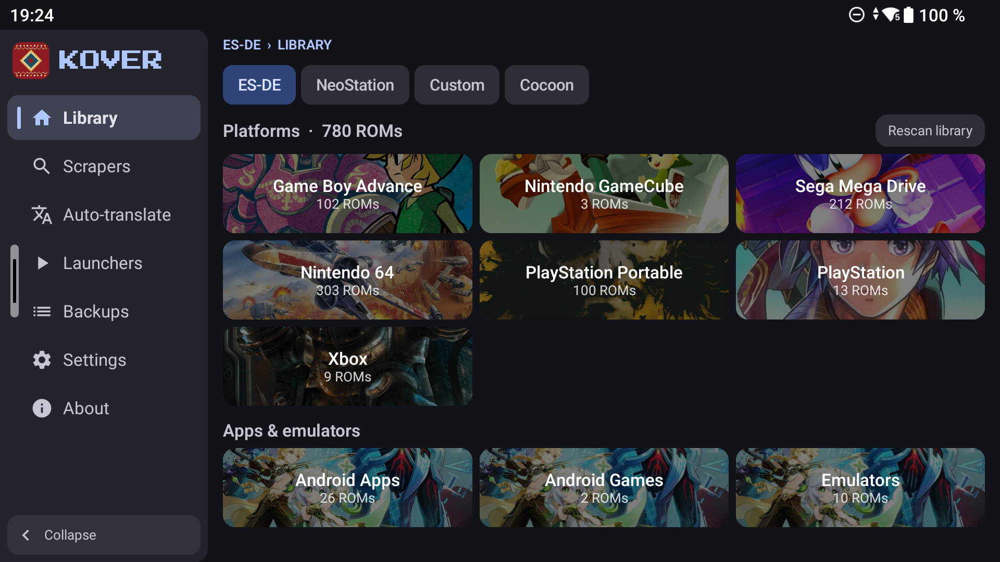
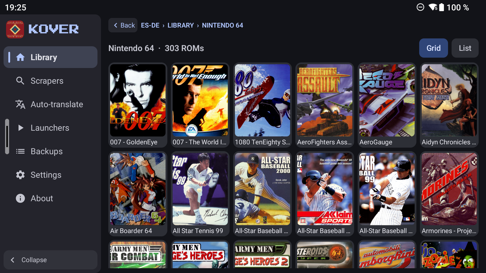
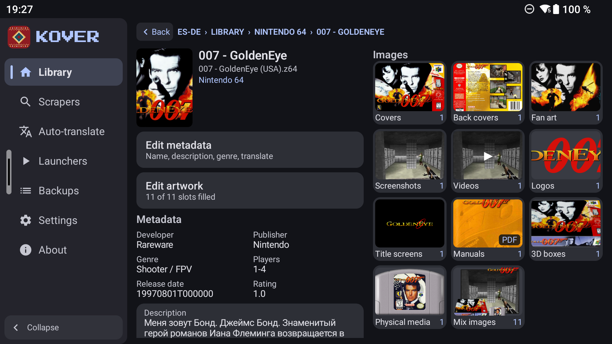
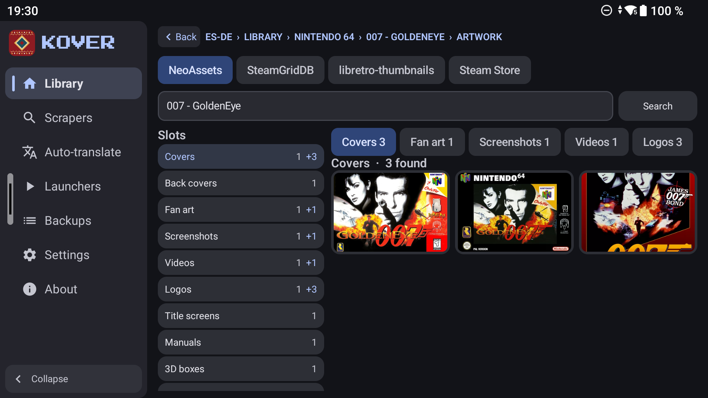
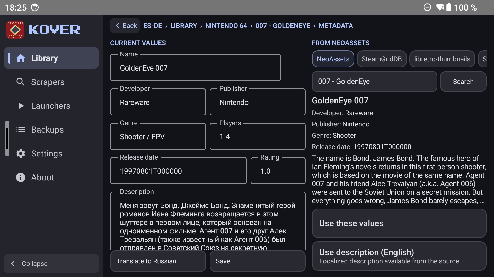
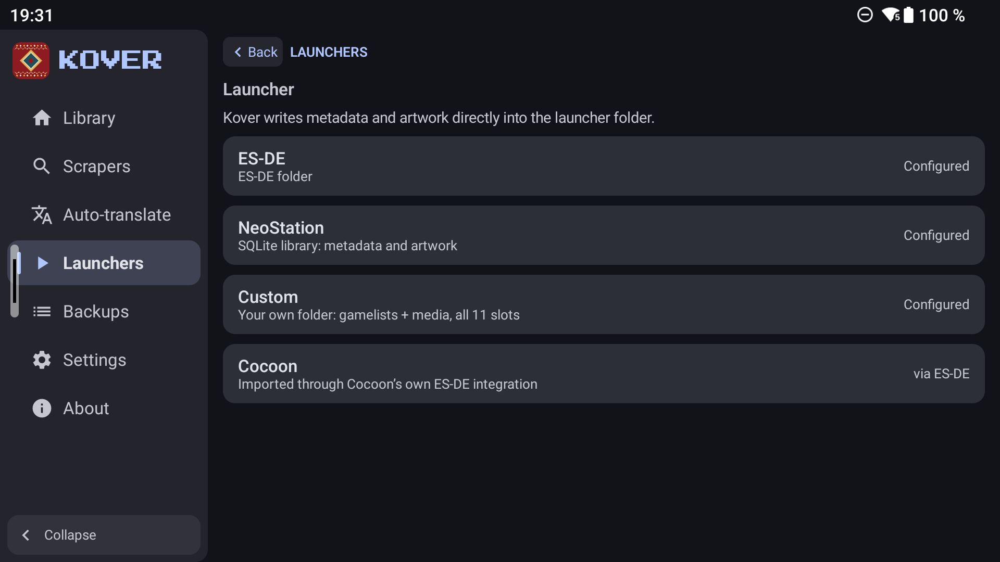
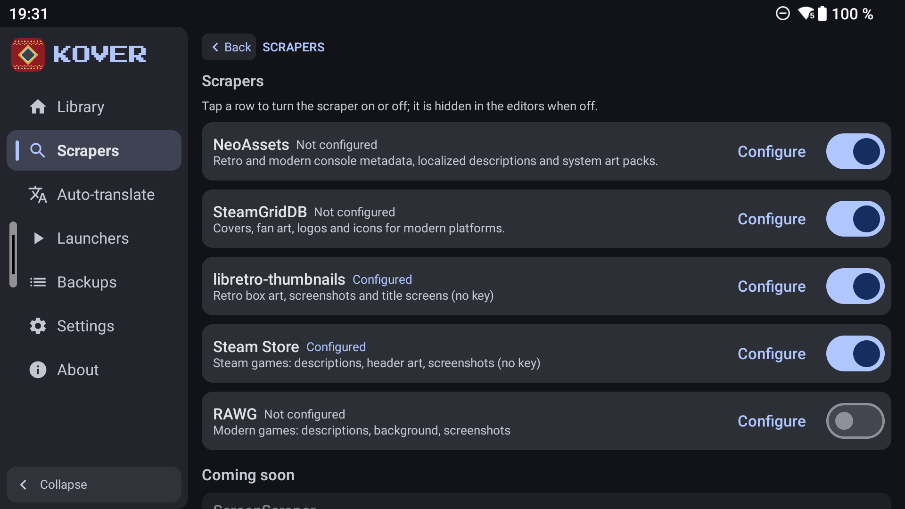
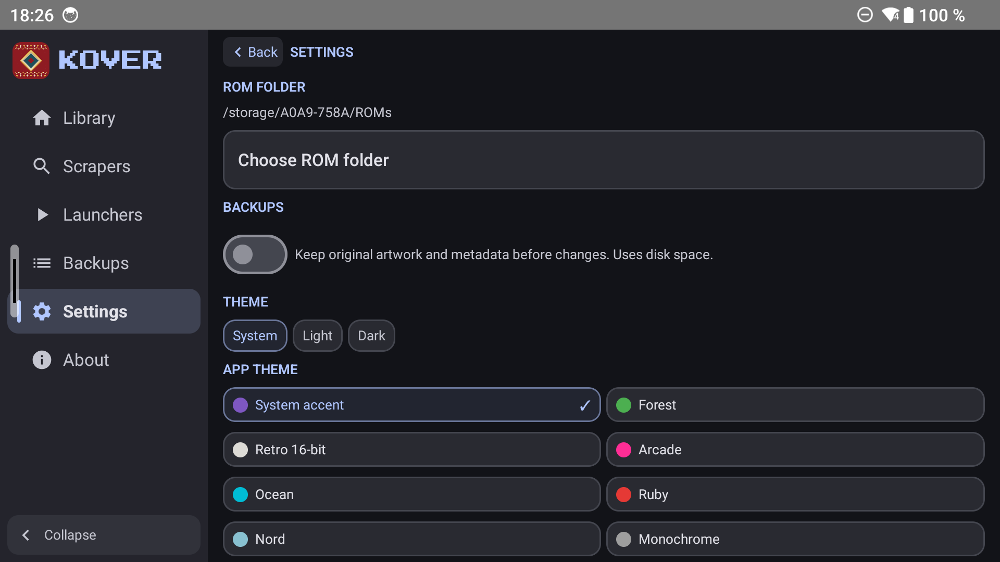

# Kover

**Artwork and metadata editor for your existing ROM library.**

Kover does not launch games and does not build a library from scratch. It opens the library you
already have, lets you fix or fill in metadata and artwork, and writes the result **directly into
your launcher's folders** — no manual copying, no XML editing by hand.

  

  <a href="README.ru.md">Русский</a> · English

---

## Why Kover

Most scrapers want to process the whole library in one go: they spend your API quota, overwrite
what you already had and take hours. Kover works the other way around:

- **You choose the game.** Open a ROM, press **Search**, pick the right match.
- **You choose the source.** NeoAssets, SteamGridDB, libretro-thumbnails or Steam Store — one at a
  time, with a visible list of what each one returned.
- **You choose what to keep.** Nothing is scraped until you press the button, and existing launcher
  data is never wiped blindly.

## Features

### Launchers

| Launcher | What Kover writes |
|---|---|
| **ES-DE** | `gamelist.xml` + `downloaded_media/{system}/{slot}` |
| **NeoStation** | `data.sqlite` (metadata) + `media/{system}/{slot}` |
| **Custom** | its own tidy folder: `gamelists/{system}/gamelist.xml` + `media/{system}/{slot}` |
| **Cocoon** | not written directly — pick up changes through Cocoon's own ES-DE import |
| **Daijisho** | not written directly — import `gamelist.xml` and media folders through Daijisho's ES-DE/Skraper import |
| **iiSU** | not written directly — link the ES-DE folder; metadata is imported and artwork stays referenced in place |

Switching between launchers takes one tap; each remembers its own data folder.

### Pack generator

A separate **Generator** section builds image packs from scratch — the active launcher is not used:

- source: **NeoAssets** or **libretro-thumbnails**, with an optional fallback to the other;
- formats: **1024×1024** icons and **1280×960** miximages;
- four layouts: **Classic**, **Hero**, **Icon Cover**, **Minimal**;
- output: `{preset}-{size}/{system}/{ROM}.png` in a folder you choose; existing files are kept unless overwrite is enabled.

ROMs are scanned from the configured ROM folder and artwork is scraped on demand. Layout previews live in
[docs/miximages](docs/miximages/).

### Scrapers

| Source | Key | Gives |
|---|---|---|
| **NeoAssets** | personal key optional (guest mode works) | metadata and localized descriptions, covers, screenshots, logos, video |
| **SteamGridDB** | personal API token | covers, heroes/fanart, logos, icons (all pages) |
| **libretro-thumbnails** | none | box art, snapshots, title screens, logos |
| **Steam Store** | none | description, genres, developer, release date, Metacritic score, header art, screenshots |
| **RAWG** | personal key | description, rating, genres, background, screenshots |
| **ScreenScraper** | — | coming soon |

Each scraper has a setup screen with instructions, a link to its key page and a **Check
connection** button. Disabled scrapers disappear from the editors.

### Editing

- **Metadata**: name, description, rating, release date, developer, publisher, genre, players.
  “Use these values” fills the form from the chosen match; descriptions in several languages are
  kept and can be translated into your language.
- **Auto-translate**: translate descriptions for whole platforms into the target language, with
  statuses, progress, cancel and a report. The job continues if you leave the screen; originals
  are kept when backups are enabled.
- **Artwork**: all 11 ES-DE slots (covers, back covers, fanart, screenshots, videos, logos,
  title screens, manuals, 3D boxes, physical media, mix images). Results are grouped by source
  category, and **the source category is independent from the target slot** — a SteamGridDB icon
  can be applied to covers, a fanart image to back covers, and so on.
- **Mix image**: Kover composes a miximage the way ES-DE does (screenshot, logo, box, media) and
  writes it as PNG.
- **Backups** (optional, off by default): the original artwork and metadata can be kept in
  `.kover-backup` and restored per file or per field.

### Comfort

- Library and platform artwork are **cached on disk**: the app opens instantly and works with a
  bad connection.
- Search and artwork writes **continue in the background** if you leave the editor screen.
- **Gamepad-first** interface: everything is focusable, B goes back, works on a handheld.
- **Themes**: system accent plus seven full palettes; light, dark or system mode.
- **Languages**: English, Русский, 中文.
- **In-app updates**: checks GitHub Releases and can download and install the APK with progress.

## Screenshots

| Library | ROM list |
|---|---|
|  |  |

| Game card | Artwork editor |
|---|---|
|  |  |

| Metadata editor | Launchers |
|---|---|
|  |  |

| Scrapers | Settings |
|---|---|
|  |  |

## Getting started

1. **Install the APK** from the [Releases](../../releases) page. Android will ask to allow
   installation from unknown sources — Kover is distributed outside Google Play.
2. **Allow file access.** On the first launch Android asks for “All files access”. Kover needs it
   to read your ROM folders and write into the launcher's folders. No root required.
3. **Pick the ROM folder** in Settings. It is the root that contains one subfolder per system
   (`n64/`, `psx/`, `switch/`, …), the layout every launcher already uses.
4. **Pick your launcher** in Launchers and point it to that launcher's data folder
   (`ES-DE`, `NeoStation`, or an empty folder for **Custom**).
5. Open **Library → platform → game** and press *Edit metadata* or *Edit artwork*.

### Editing metadata

1. Press **Search** — nothing is requested before that.
2. Pick the right match from the candidate list if there are several.
3. Press **Use these values** (and *Use description* for the localized text).
4. Fix anything by hand and press **Save**. Only Kover's fields are touched; other launcher data
   stays as it was.

### Editing artwork

1. Choose the scraper chip and press **Search**.
2. Pick a source category on the right (Covers, Fanart, Icons, …).
3. Tap an image to preview it.
4. Choose the target slot at the bottom of the dialog and press **Apply**.

## Good to know

- **No automatic scraping.** The library is never scraped in the background; API quota is spent
  only when you press *Search*.
- **NeoStation must be closed while saving.** It keeps its database in memory and reloads it on
  start.
- **Backups are off by default** to save space on handhelds. Turn them on in *Settings → Backups*
  if you are about to rewrite a lot of artwork.
- **Custom folder format** is Kover's own: one `gamelist.xml` per system and one file per slot,
  named after the ROM file. It is readable, but it is not an ES-DE-compatible format.
- **RAWG** depends on their service availability; the rest work without registration.

## Requirements

- Android 11 or newer, landscape screen.
- A gamepad is recommended (the interface is built for it), touch works too.
- An existing ROM library and a supported launcher.

## License

Kover is free software, licensed under the **GNU General Public License v3.0 (GPL-3.0-only)**.
See [LICENSE](LICENSE). Third-party components and their licenses are listed in
[THIRD_PARTY_NOTICES.md](THIRD_PARTY_NOTICES.md).

Game titles, cover art and trademarks belong to their respective owners. Kover is not affiliated
with ES-DE, NeoStation, Cocoon, Daijisho, iiSU, NeoAssets, SteamGridDB, Steam, RAWG or ScreenScraper.

## Links

- **GitHub**: <https://github.com/Stezkoy/Kover>
- **Support the project**: <https://boosty.to/stezkoy>
- **Русская версия README**: [README.ru.md](README.ru.md)
