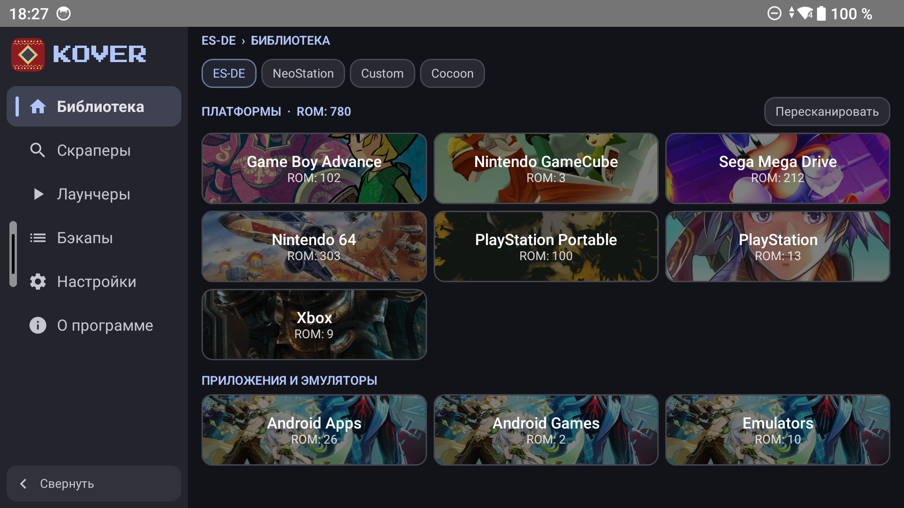
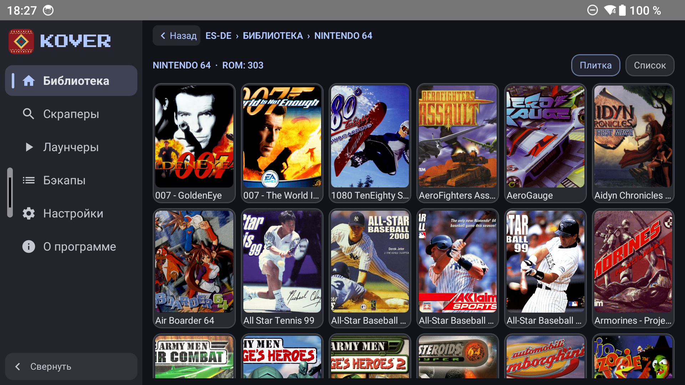
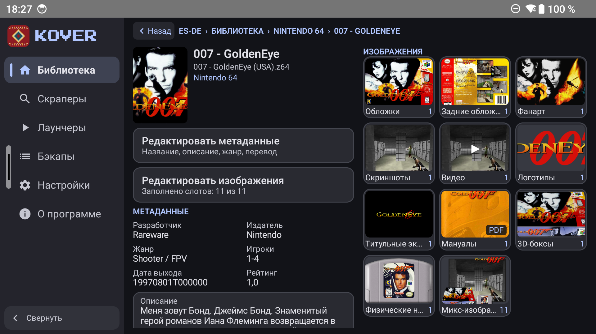
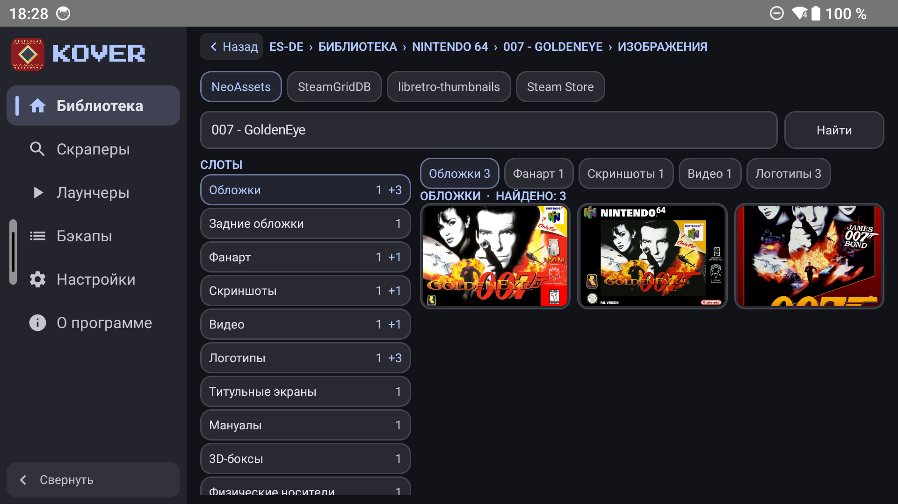
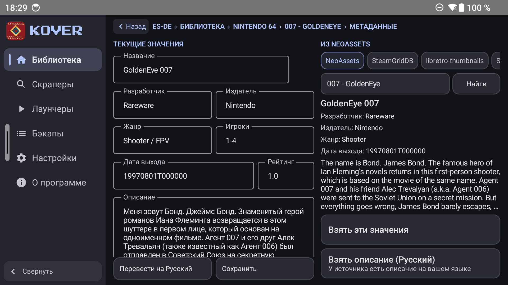
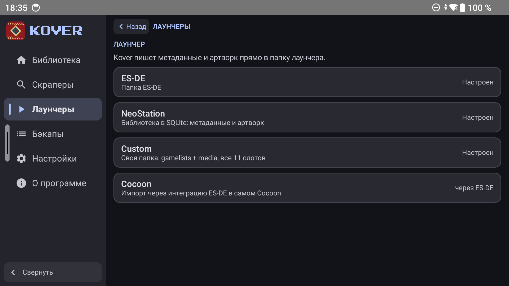
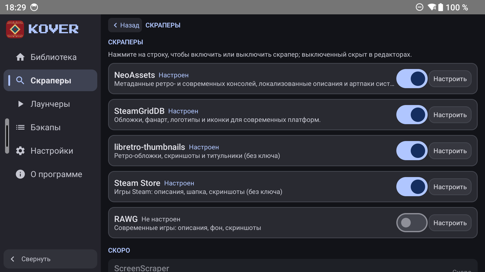
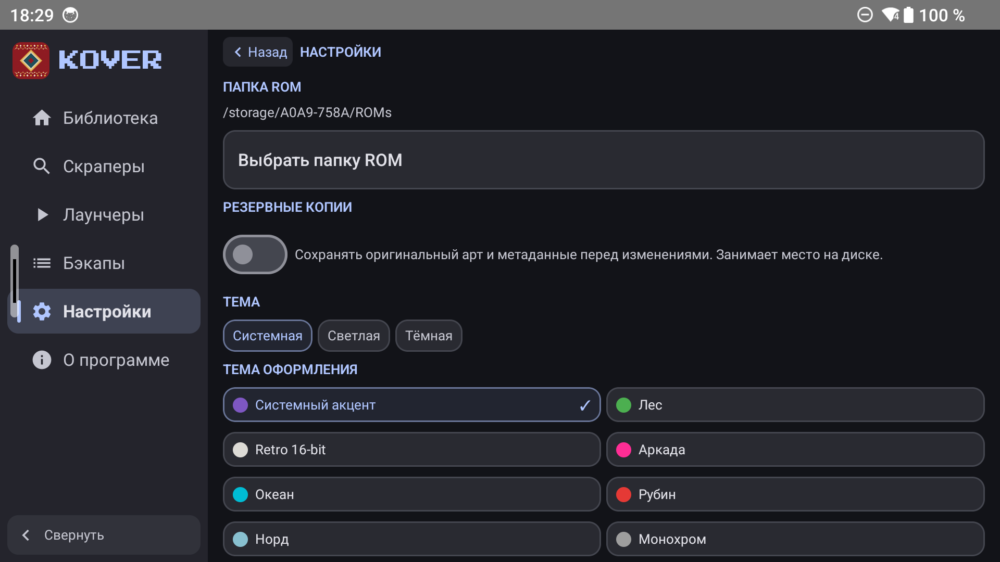

# Kover

**Редактор артворка и метаданных для уже готовой ROM-библиотеки.**

Kover не запускает игры и не собирает библиотеку с нуля. Он открывает то, что у вас уже есть,
позволяет поправить или заполнить описание и обложки и **записывает результат прямо в папки
лаунчера** — без ручного копирования файлов и правки XML.

  

  Русский · <a href="README.md">English</a>

---

## Зачем нужен Kover

Большинство скрейперов пытаются обработать всю библиотеку сразу: тратят квоту API, затирают то,
что уже было настроено, и занимают часы. Kover работает наоборот:

- **Вы выбираете игру.** Открыли ROM, нажали «Найти», выбрали правильный вариант.
- **Вы выбираете источник.** NeoAssets, SteamGridDB, libretro-thumbnails или Steam Store — по
  одному, с наглядным списком того, что вернул каждый.
- **Вы решаете, что оставить.** Ничего не скрейпится до нажатия кнопки, а существующие данные
  лаунчера не затираются вслепую.

## Возможности

### Лаунчеры

| Лаунчер | Что пишет Kover |
|---|---|
| **ES-DE** | `gamelist.xml` + `downloaded_media/{система}/{слот}` |
| **NeoStation** | `data.sqlite` (метаданные) + `media/{система}/{слот}` |
| **Custom** | своя аккуратная папка: `gamelists/{система}/gamelist.xml` + `media/{система}/{слот}` |
| **Cocoon** | напрямую не пишет — изменения подхватывает импорт ES-DE самого Cocoon |

Переключение между лаунчерами — одно нажатие; у каждого запоминается своя папка данных.

### Скраперы

| Источник | Ключ | Что даёт |
|---|---|---|
| **NeoAssets** | личный ключ по желанию (работает гостевой режим) | метаданные и локализованные описания, обложки, скриншоты, логотипы, видео |
| **SteamGridDB** | личный API-токен | обложки, fanart, логотипы, иконки (все страницы) |
| **libretro-thumbnails** | не нужен | обложки, снимки, титульные экраны, логотипы |
| **Steam Store** | не нужен | описание, жанры, разработчик, дата выхода, рейтинг Metacritic, шапка, скриншоты |
| **RAWG** | личный ключ | описание, рейтинг, жанры, фон, скриншоты |
| **ScreenScraper** | — | скоро |

На экране каждого скрейпера есть инструкция, ссылка на страницу ключей и кнопка **«Проверить
подключение»**. Отключённые скрейперы не показываются в редакторах.

### Редактирование

- **Метаданные**: название, описание, рейтинг, дата выхода, разработчик, издатель, жанр, игроки.
  Кнопка «Взять эти значения» заполняет форму из выбранного совпадения; описания на разных
  языках сохраняются, а кнопка перевода (MyMemory) переводит их на ваш язык.
- **Артворк**: все 11 слотов ES-DE (обложки, задние обложки, фанарт, скриншоты, видео, логотипы,
  титульные экраны, мануалы, 3D-боксы, физические носители, микс-изображения). Результаты
  сгруппированы по категориям источника, и **категория источника не зависит от слота-цели**:
  иконку SteamGridDB можно положить в обложки, фанарт — в задние обложки и так далее.
- **Микс-изображение**: Kover собирает его по логике ES-DE (скриншот, логотип, бокс, носитель)
  и сохраняет PNG.
- **Бэкапы** (по желанию, по умолчанию выключены): оригинальный арт и метаданные можно сохранять
  в `.kover-backup` и восстанавливать по одному файлу или полю.

### Удобство

- Библиотека и арт платформ **кэшируются на диск**: приложение открывается мгновенно и работает
  при плохом интернете.
- Поиск и запись арта **продолжаются в фоне**, если вы ушли с экрана редактора.
- **Интерфейс под геймпад**: всё фокусируется, B — назад, удобно на портативной консоли.
- **Темы**: системный акцент и семь полных палитр; светлый, тёмный или системный режим.
- **Языки**: English, Русский, 中文.
- **Обновления внутри приложения**: проверка GitHub Releases, скачивание и установка APK
  с прогрессом.

## Скриншоты

| Библиотека | Список ROM |
|---|---|
|  |  |

| Карточка игры | Редактор арта |
|---|---|
|  |  |

| Редактор метаданных | Лаунчеры |
|---|---|
|  |  |

| Скраперы | Настройки |
|---|---|
|  |  |

## С чего начать

1. **Установите APK** со страницы [Releases](../../releases). Android попросит разрешить
   установку из неизвестных источников — Kover распространяется вне Google Play.
2. **Разрешите доступ к файлам.** При первом запуске Android спросит «Доступ ко всем файлам».
   Без этого нельзя читать ROM и писать в папки лаунчера. Root не нужен.
3. **Выберите папку ROM** в Настройках. Это корень, внутри которого по папке на систему
   (`n64/`, `psx/`, `switch/`, …) — такая структура уже есть у любого лаунчера.
4. **Выберите лаунчер** в разделе «Лаунчеры» и укажите его папку данных (`ES-DE`, `NeoStation`
   или пустую папку для **Custom**).
5. Откройте **Библиотека → платформа → игра** и нажмите «Редактировать метаданные» или
   «Редактировать изображения».

### Редактирование метаданных

1. Нажмите **«Найти»** — до этого никаких запросов нет.
2. Если вариантов несколько, выберите нужный в списке кандидатов.
3. Нажмите **«Взять эти значения»** (и «Взять описание» для локализованного текста).
4. Поправьте что нужно вручную и нажмите **«Сохранить»**. Kover трогает только свои поля,
   остальные данные лаунчера остаются как были.

### Редактирование арта

1. Выберите чип скрейпера и нажмите **«Найти»**.
2. Справа выберите категорию источника (Обложки, Фанарт, Иконки, …).
3. Нажмите на картинку для предпросмотра.
4. Внизу диалога выберите слот-цель и нажмите **«Применить»**.

## Полезно знать

- **Автоматического скрейпинга нет.** Библиотека никогда не скрейпится в фоне; квота API
  тратится только по нажатию «Найти».
- **NeoStation нужно закрыть перед сохранением.** Он держит базу в памяти и перечитывает её
  при запуске.
- **Бэкапы по умолчанию выключены**, чтобы не занимать место на приставке. Включить можно в
  «Настройки → Резервные копии», если собираетесь массово перезаписывать арт.
- **Формат Custom** — собственный формат Kover: один `gamelist.xml` на систему и один файл на
  слот, с именем ROM-файла. Он читаемый, но не совместим с ES-DE.
- **RAWG** зависит от доступности их сервиса; остальные работают без регистрации.

## Требования

- Android 11 или новее, ландшафтный экран.
- Желателен геймпад (интерфейс рассчитан на него), сенсор тоже работает.
- Готовая ROM-библиотека и поддерживаемый лаунчер.

## Лицензия

Kover — свободное ПО под **GNU General Public License v3.0 (GPL-3.0-only)**.
Полный текст: [LICENSE](LICENSE). Сторонние компоненты и их лицензии:
[THIRD_PARTY_NOTICES.md](THIRD_PARTY_NOTICES.md).

Названия игр, обложки и товарные знаки принадлежат их владельцам. Kover не связан с ES-DE,
NeoStation, Cocoon, NeoAssets, SteamGridDB, Steam, RAWG и ScreenScraper.

## Ссылки

- **GitHub**: <https://github.com/Stezkoy/Kover>
- **Поддержать проект**: <https://boosty.to/stezkoy>
- **English README**: [README.md](README.md)
